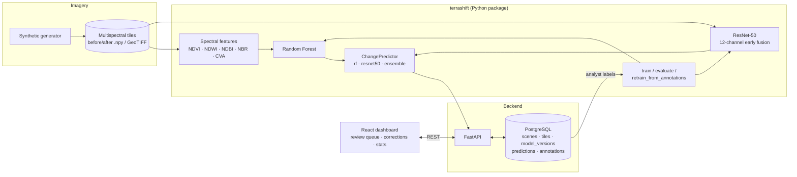

# TerraShift

Proof-of-concept for **land-use change detection in multispectral satellite imagery**.
Given two co-registered acquisitions of the same tile (before / after), TerraShift classifies
the change as one of:

`no_change` · `vegetation_loss` · `urban_expansion` · `water_change` · `agricultural_change`

It combines two models, a REST API with PostgreSQL storage, and a React dashboard where analysts
review predictions and submit correction labels that feed back into retraining.

- **ResNet-50 (PyTorch):** bi-temporal early fusion. Both dates' 6 bands are stacked into a 12-channel
  input. The first conv is widened, and the ImageNet RGB filters are reused for the red/green/blue channels.
- **Random Forest (scikit-learn):** about 150 hand-crafted features. These include per-band deltas;
  NDVI, NDWI, NDBI and NBR statistics before, after and as a delta; fractions of pixels crossing change
  thresholds; and the change-vector-analysis magnitude.
- **Ensemble:** a weighted average of both models' probabilities (CNN 0.6 / RF 0.4).
- **FastAPI + PostgreSQL:** stores scenes, tiles, model versions, predictions and annotations.
  It serves an active-learning review queue (lowest confidence, highest entropy, or predicted
  changes first), RGB and index-difference previews, stats, and an export of corrected labels.
- **React dashboard:** a review queue, before/after/ΔNDVI imagery, class probabilities, and a
  one-click confirm/correct form with keyboard shortcuts. It also has a stats view with a
  model-vs-analyst confusion matrix.

## Architecture



### Repository layout

```
terrashift/        ML package: data layer, features, models, training
  data/            bands & classes, spectral indices, tile I/O, synthetic generator, torch dataset
  models/          random_forest.py, resnet.py, predictor.py
  training/        train_rf.py, train_cnn.py, metrics.py
api/               FastAPI app, SQLAlchemy models, CRUD, inference service, routers
db/schema.sql      Canonical PostgreSQL DDL (applied automatically by docker-compose)
dashboard/         React + Vite + TypeScript review UI
scripts/           generate_synthetic, train, evaluate, seed_db, retrain_from_annotations
tests/             pytest suite (data, models, API against SQLite)
```

### Data format

Each tile pair is stored as two float32 arrays of shape `(6, H, W)`, holding reflectance in [0, 1]
with the bands in the order `blue, green, red, nir, swir1, swir2`. A `manifest.json` lists the pairs:

```json
[{"tile_id": "abc", "before": "tiles/abc_t0.npy", "after": "tiles/abc_t1.npy", "label": "urban_expansion", "lat": 12.3, "lon": 45.6}]
```

GeoTIFFs (for example, Sentinel-2 L2A stacks scaled by 10000) also work if you install `.[geo]`.
The included synthetic generator builds realistic-looking pairs from land-cover spectral endmembers.
It adds class-specific changes, radiometric noise and illumination shifts. This lets you run the whole
pipeline without downloading any imagery.

## How to run

### Prerequisites

- Python 3.10+, Node 18+, and PostgreSQL 14+ (or Docker)
- A GPU is optional. ResNet-50 trains on CUDA, Apple MPS or CPU (`TERRASHIFT_DEVICE`); CPU training on
  the default synthetic set is slow, so use `--epochs 3` or `--model rf` for a quick start.
- The first ResNet-50 run downloads ImageNet weights from the PyTorch hub. Use `--no-pretrained` to skip that.

### Local setup

```bash
cp .env.example .env              # set DATABASE_URL / POSTGRES_PASSWORD
python -m venv .venv && source .venv/bin/activate
make install                      # pip install -e ".[api,dev]"

make data                         # synthetic train (data/synthetic) + test (data/test) sets
make train                        # RF + ResNet-50 -> artifacts/
make evaluate                     # per-class metrics for rf / resnet50 / ensemble on data/test

createdb terrashift && psql terrashift -f db/schema.sql   # or let the API create tables
make api                          # http://localhost:8000/docs
make seed                         # creates a demo scene, imports tiles, runs predictions
make dashboard                    # http://localhost:5173
```

### Docker

```bash
cp .env.example .env              # set POSTGRES_PASSWORD
make data train                   # produce data/ and artifacts/ on the host (mounted into the API)
docker compose up --build -d      # postgres :5432, api :8000, dashboard :8080
docker compose exec api python -m scripts.seed_db --predict
```

### Analyst feedback loop

1. Open the dashboard and pick a scene. Work through the queue: press `1`–`5` to choose a class and
   `Enter` to confirm or correct.
2. Export the labels with `GET /annotations/export`, or retrain directly from the database:
   ```bash
   python -m scripts.retrain_from_annotations --base-manifest-dir synthetic --model rf
   curl -X POST localhost:8000/models/reload
   ```
   Corrected tiles are up-weighted (`--correction-weight`), and analyst labels override any reference labels.

### Key API endpoints

| Method | Path | Purpose |
|---|---|---|
| `POST` | `/scenes` · `/scenes/{id}/import` · `/scenes/{id}/tiles` | Register scenes and tiles |
| `POST` | `/tiles/{id}/predict` · `/scenes/{id}/predict` | Run a model (`auto`, `random_forest`, `resnet50` or `ensemble`) |
| `GET` | `/review/queue?strategy=uncertainty\|entropy\|changes` | Active-learning review queue |
| `GET` | `/tiles/{id}` · `/tiles/{id}/preview/{before\|after\|ndvi_diff}.png` | Tile detail and previews |
| `POST` | `/tiles/{id}/annotations` | Confirm, correct or skip (the action is inferred if omitted) |
| `GET` | `/stats` · `/annotations/export` · `/models` | Review stats, labels for training, and loaded models |

## How to test

```bash
make test        # or: python -m pytest -q
```

The suite needs no PostgreSQL, GPU or downloads. It points the API at a temporary SQLite database and
generates a small synthetic dataset. It covers:

- **Data:** index sign checks on endmembers, generator shapes and ranges, stratified splits and augmentation.
- **Models:** feature/name alignment, RF accuracy above chance and save/load round-trip, ResNet-50
  forward pass and checkpoint round-trip, and ensemble probabilities summing to 1.
- **API:** the end-to-end flow of import → batch predict → uncertainty-ordered queue → confirm/correct →
  stats and agreement rate → export. It also covers validation errors, path-escape protection and PNG previews.

To type-check the dashboard, run `cd dashboard && npm install && npm run typecheck`.

## Limitations

This is a proof-of-concept. It classifies whole tiles rather than producing pixel-level change masks.
The synthetic data is useful for plumbing and sanity checks, but it is no substitute for labelled
real-world imagery such as OSCD or xBD-style datasets converted to the manifest format.
